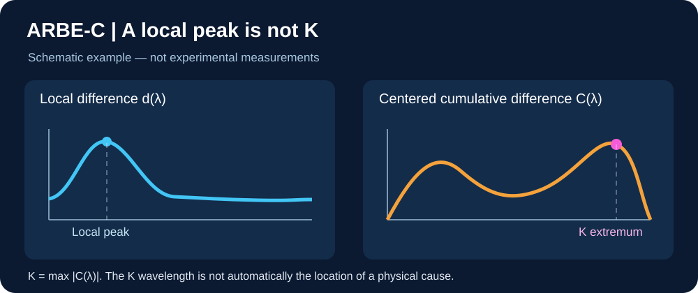
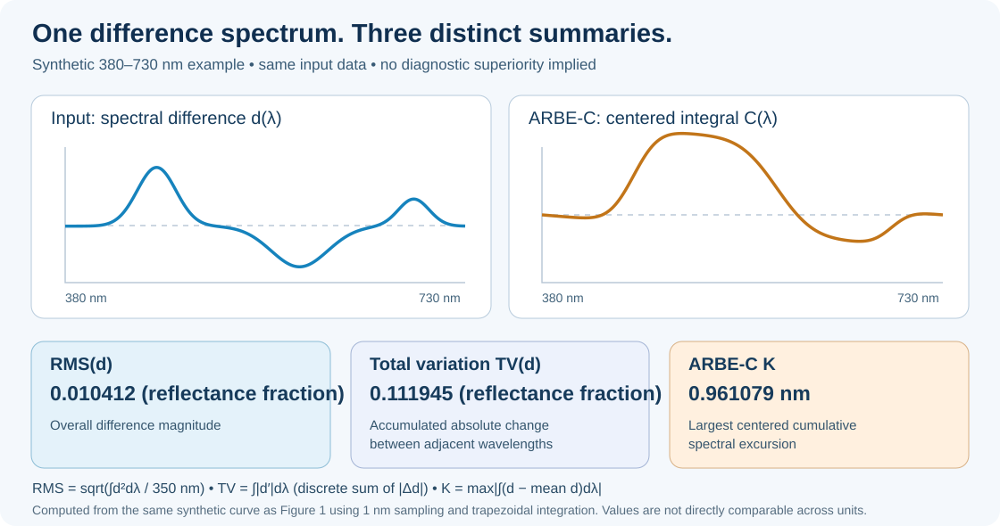

# 🔬 ARBE-C: Why the Highest Spectral Peak Is Not the K Value

*Understanding local spectral changes, cumulative differences, and spectral balance*

> **Research status (12 November 2026):** ARBE-C is an **experimental, independently unvalidated diagnostic prototype**. The first two numerical illustrations use **synthetic spectra calculated from a defined difference function**. A separate third figure displays **real PET reflectance measurements** from two measurement blocks, without a verified before/after ageing pairing. Neither type of illustration establishes diagnostic superiority.

## 🔍 Three different questions

When comparing reflectance measurements before and after an intervention, three different questions arise:

1. **Where is reflectance highest?** Inspect the original reflectance spectrum, \(R(\lambda)\).
2. **Where is the largest local difference?** Inspect \(d(\lambda)=R_{\mathrm{after}}(\lambda)-R_{\mathrm{before}}(\lambda)\).
3. **Where is the largest absolute cumulative excursion after centering?** Inspect the experimental **ARBE-C** curve and its scalar **K**.

The highest reflectance peak, the largest pointwise difference, and K are **not interchangeable**.

## 📐 What K actually measures

For the fixed wavelength interval 380–730 nm, define

\[
\overline d=\frac{1}{350\,\mathrm{nm}}\int_{380\,\mathrm{nm}}^{730\,\mathrm{nm}}d(\lambda)\,d\lambda,
\]

\[
C(x)=\int_{380\,\mathrm{nm}}^{x}\bigl[d(\lambda)-\overline d\bigr]\,d\lambda,
\qquad
K=\max_{x\in[380,730]\,\mathrm{nm}}|C(x)|.
\]

When reflectance is represented as a dimensionless fraction, K is measured in **nanometres**. K is the **largest absolute excursion of the mean-centered cumulative difference**, not the maximum of either original reflectance spectrum and not the maximum of the local difference spectrum.

For sufficiently smooth spectra, \(C'(x)=d(x)-\overline d\). An interior extremum of C therefore occurs where the local difference crosses its mean, not necessarily at a peak of \(d\). The wavelength of the K extremum **does not by itself identify the center of a chemical or physical material change**.

The figure above is a numerically calculated **synthetic example**, not independent measurements. The C-curve is integrated from exactly the displayed difference function at 1 nm intervals.

## 🌈 How ARBE λ* fits in

The existing [ARBE λ*_V2 specification](../../README.md) establishes an important mathematical identity on the fixed interval:

\[
\lambda^*_{V2}=380\,\mathrm{nm}+350\,\mathrm{nm}\cdot\overline R.
\]

Thus, λ*_V2 is an **affine encoding of unweighted mean reflectance**: it does not contain additional information beyond that mean on the specified interval. This must be stated plainly rather than implying otherwise.

- **λ*_V2:** Integral-balance descriptor, equivalent to the unweighted mean reflectance after the specified affine transformation.
- **λ*_EE:** Energy-weighted spectral centroid (first moment), subject to the documented normalization.
- **Δλ*:** Signed descriptor \(\lambda^*_{V2}-\lambda^*_{EE}\).
- **ARBE-C:** Comparison of the *shape of the difference* between two spectra after removing its constant additive component.

These descriptors summarize different aspects of spectra, but they are all computed from spectral data; their agreement is **not independent experimental confirmation**.

## 🧪 Why centering matters

If \(R_{\mathrm{after}}(\lambda)=R_{\mathrm{before}}(\lambda)+a\) with a constant additive offset \(a\), then \(d(\lambda)=a\), so \(C(x)=0\) and \(K=0\).

That **does not prove no material change occurred**: K deliberately ignores uniform additive shifts. By contrast, λ*_V2 changes with mean reflectance under such an offset, while the response of λ*_EE depends on the original spectrum and normalization. For a *multiplicative* scaling of reflectance, the normalized centroid stays fixed; additive and multiplicative changes must not be conflated.

## ⚖️ Comparing ARBE-C with RMS and total variation

The figure applies three distinct summaries to **the same synthetic difference spectrum** \(d(\lambda)\), sampled from 380 to 730 nm in 1 nm steps:

- **RMS** quantifies overall difference magnitude: \(\sqrt{\int d(\lambda)^2\,d\lambda / (350\,\mathrm{nm})}\).
- **Total variation (TV)** quantifies accumulated absolute variation along wavelength: \(\int |d'(\lambda)|\,d\lambda\), approximated by the sum of adjacent absolute differences.
- **ARBE-C K** quantifies the largest absolute excursion of the **mean-centered cumulative difference**, while the full C-curve retains its wavelength-dependent shape.

For this specific synthetic function, numerical results are RMS **0.010412** (reflectance fraction), TV **0.111945** (reflectance fraction), and K **0.961079 nm**. **Their units and interpretations differ; comparing the numerical magnitudes as if they were competing scores would be invalid.** The same source function is used in both figures, and the integral C-curve returns to approximately zero at 730 nm by construction.

The figure is **not a benchmark**: one deliberately constructed curve cannot establish additional detection power, reliability or practical diagnostic benefit. Those claims require prespecified independent test data, relevant endpoints, noise/resolution robustness checks and fair baselines.

## 🧫 Real PET measurements: a separate illustrative comparison

**Source and interpretation.** This figure uses measured PET reflectance spectra from the de-Vries dataset. It compares **two measurement blocks with five technical replicates each**. The blocks are **not established as a matched untreated-versus-aged pair**. Accordingly, the figure illustrates spectral comparison and ARBE-C computation, **not the detection of ageing or a known material change**.

For this particular pair of measurement groups, the reported calculations are:

| Quantity | Result |
| --- | ---: |
| Wavelength of the largest absolute local spectral difference | **730 nm** |
| Wavelength of the maximum absolute centered cumulative excursion | **639 nm** |
| ARBE-C scalar \(K\) | **0.096105 nm** |

The **730 nm** result lies at the **upper boundary** of the measured wavelength interval; it should not be interpreted as an interior spectral peak or a confirmed physical damage location. The distinct **639 nm** location arises from integrating the mean-centered difference, not from a second independent measurement. The centered cumulative curve returns to approximately zero at the endpoint by construction.

**Data and reproducibility limits.** This image is hosted on the ARBE website rather than committed as a binary file in this repository. The displayed values are reported for the selected comparison; this section does not yet include the complete source spectra, block identifiers, calculation script, or an independent reproduction of the numbers. Those materials are needed for a fully auditable experimental example. No claims of superiority over RMS, total variation, or established diagnostics follow from this illustration.

## ✅ Detection is not confirmation

A measured spectral difference is not, by itself, proof of a specific material cause. Repeated measurements, appropriate controls, and independent physical or chemical evidence remain necessary. **Neither K nor the C-curve shape alone confirms material degradation.**

## ⚖️ What remains unproven

ARBE-C is a deterministic transformation of the original difference spectrum; it **does not create new information**. No general diagnostic accuracy advantage over RMS, total variation, derivatives, or established multivariate approaches has been demonstrated.

A practical hypothesis remains worth testing: does a unified view of **K, the full C-curve, candidate wavelength positions, ARBE descriptors, and transparent verification status** help practitioners interpret measurements and make better decisions?

That requires independent datasets with documented material changes, predefined endpoints, reproducibility assessment, and fair baseline comparisons.

## 🚀 Invitation to independent testing

Researchers, laboratories, instrument specialists, and industrial quality teams are invited to contribute independent before/after spectra, technical replicates, and critical comparisons. The [ARBE CSV research quickstart](../tools/delta-csv-quickstart.md) documents a separate λ* and Δλ* evaluation workflow; it should **not** be presented as validation of ARBE-C.

**More than a peak. More than a number. A transparent experimental diagnostic workflow.**

*ATLAS Clarus / ARBE-C — Research communication, not a validated diagnostic claim.*
