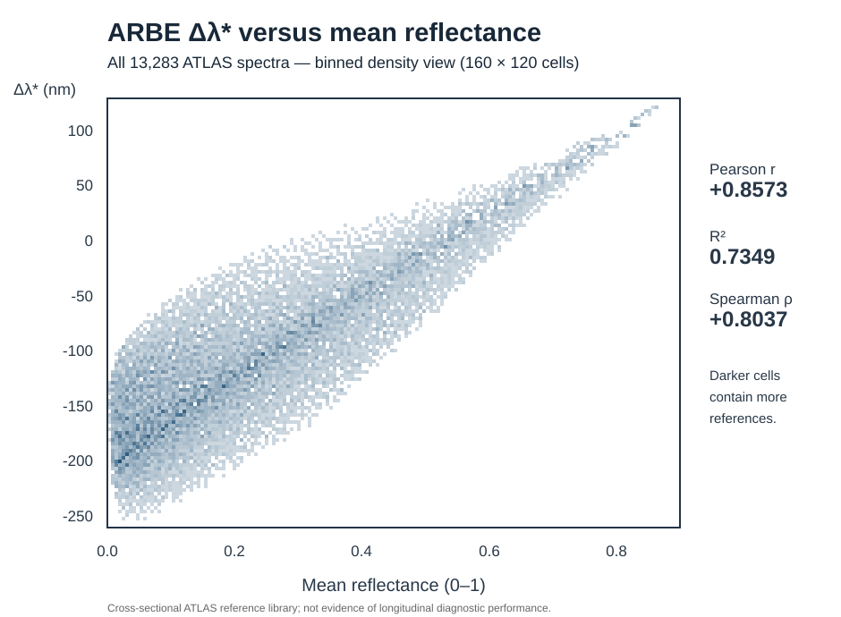

# John Seymour correlation test — 13,283 ATLAS reference spectra (2026-11-15)

## Research question

John Seymour suggested plotting ARBE Δλ* against mean reflectance over the entire reference-spectra collection. This analysis addresses that question **for the ATLAS HLC library**, not for independent longitudinal material-aging observations.

## Dataset and method

- **N = 13,283** ATLAS reference spectra; one reference per row.
- **Wavelength range:** 380–730 nm inclusive, in 10 nm increments (36 values per reference).
- **Input provenance:** trusted ATLAS master `atlas_master__active_master__v2_illumext(20261115-082821).pkl`; SHA-256: `8283ab91b10f89ac758d09ecf5fb4d6343536600a06dd468b1cc1ecf4ec747c4`.
- **Reflectance:** fractions on a 0–1 scale.
- **Integration:** composite trapezoidal rule over the specified wavelength grid, with no smoothing.

Let `R(λ)` denote spectral reflectance. Definitions used:

```text
mean R = integral_380^730 R(λ) dλ / (730 − 380)
λ*V2   = 380 nm + (350 nm) × mean R
λ*EE   = integral_380^730 λ R(λ) dλ / integral_380^730 R(λ) dλ
Δλ*    = λ*V2 − λ*EE
```

The centroid is defined only if the reflectance integral is positive. Pearson r is the linear correlation between mean reflectance and Δλ*; R² is r squared for a one-predictor linear regression with an intercept. Spearman ρ assesses rank correlation. The results below are cross-sectional, calculated across references rather than over time.

## Verified results

| Statistic | Result |
| --- | ---: |
| Valid references | 13,283 |
| Pearson r | **+0.857275885** |
| R² | **0.734921943** |
| Spearman ρ | **+0.803685334** |
| Mean reflectance range | 0.003685714 – 0.864864286 |
| λ*EE range | 464.404887 – 657.703231 nm |
| Δλ* range | −251.648172 – +121.054397 nm |

The correlation is strong but not perfect. The coefficient is a property of the particular distribution of these ATLAS spectra; its magnitude is not prescribed by the algebra alone. The two-variable definition of Δλ* is exact, however: Δλ* adds no independent information beyond mean reflectance and λ*EE.

**Interpretation:** 73.49% of the cross-sectional variance in Δλ* is explained by the least-squares straight-line fit to mean reflectance alone. The remaining 26.51% is unexplained *by that particular linear fit*, not evidence of a new physical measurement.

These data **do not** establish superiority for material-aging detection, earlier warning of trend reversals, or an independent scientific novelty claim. Those hypotheses require prospective or held-out longitudinal data and comparisons against both original descriptors evaluated jointly.

## Reproduction

Install Python packages `numpy`, `pandas`, `matplotlib`, then run from the repository root:

```bash
python tools/seymour_atlas_correlation.py /path/to/trusted/atlas_master.pkl --out results/seymour-atlas
```

The script verifies the 13,283-row size, unique addresses, the 36 reflectance columns, finite 0–1 values and nonzero integrated reflectance; it exports the full per-reference CSV and regenerates the scatterplot.

**Input data availability:** the master pickle is not bundled with this repository. The reproducibility script therefore needs an independently obtained, authorized copy of the input master. Only load pickle files from trusted sources.

## Local calculation artifacts and checksums

The following two generated outputs were independently calculated and checked during preparation; **they are not attached to this GitHub document unless their files are separately committed**:

| File | SHA-256 |
| --- | --- |
| `ARBE_Seymour_ATLAS_13283_Einzelwerte.csv` | `1e07fcbb550263d72df3ecaba32ea62b559d70466abe1f2b76d61ba56c0c588f` |
| `ARBE_Seymour_ATLAS_13283_Streudiagramm.png` | `f91867ad0ec546c481f20ef21e344727d665e308b2bdbc40ef05bdfb50dc6605` |

The regeneration script may produce a different bytewise checksum because of CSV formatting and Matplotlib rendering settings; verify numeric agreement, not file-byte identity.

## Scientific distinction

The scatterplot probes a **cross-sectional** statistical dependence among reference colors. The ARBE longitudinal hypothesis asks whether the signed temporal evolution of a wavelength-scaled mean-reflectance descriptor relative to a reflectance-weighted centroid provides an interpretable or decision-relevant signal. This second question has **not** been answered by the correlation test.

Earlier work proposing an equivalent mathematical descriptor would be highly relevant. An exhaustive novelty search has not yet been completed.

## Public visualization (all 13,283 references)



[Open the SVG density plot](seymour-atlas-density-13283.svg). It aggregates the **entire** 13,283-reference dataset into 160 × 120 bins (4,498 nonempty cells, summed density counts = 13,283). This is a binned view and **not** the original point-by-point PNG. The source CSV and the original PNG remain separate local artifacts until committed explicitly.
